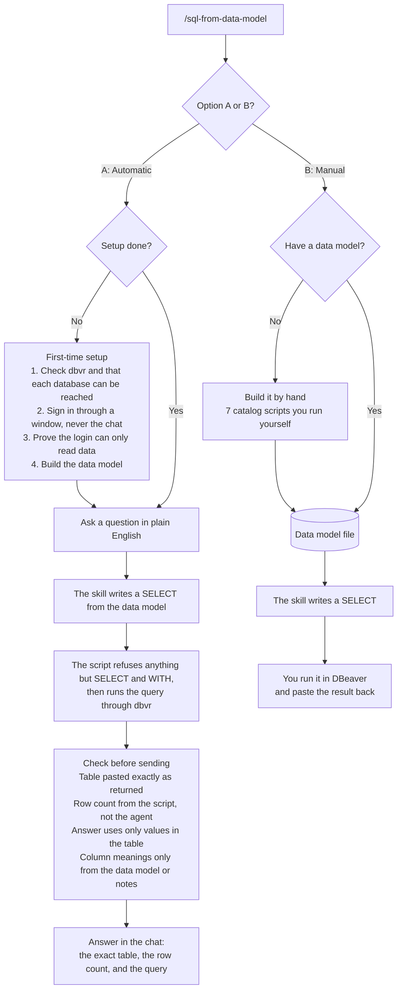

# SQL from a data model

An agentic, read-only database assistant for SQL Server and Azure SQL. You ask a question in plain English, such as *How many orders does customer C-1001 have?*, and the agent does the database work from start to finish:

1. **Sets itself up.** It checks that dbvr is installed and every database can be reached. It opens a sign-in window for your username and password, never the chat. Then it checks that each login can sign in.
2. **Learns the database.** It runs 7 read-only catalog scripts and writes a data model: a map of every table, column, and key.
3. **Answers.** It picks the right database and tables from the data model, writes the query, runs it, and checks its answer against the result before replying. Queries that worked are saved next to the data model, so the same kind of question later reuses a tested query.

It never changes data. The script refuses anything but `SELECT` and `WITH`, whichever login you use. A read-only login is still the safest choice. The agent doesn't guess either: it uses only tables and columns in the data model, and only values that came back from the database.

It is one skill, `/sql-from-data-model`, with two options:

- **Option A: Automatic.** The agent does all three steps above and answers in the chat. Needs dbvr.
- **Option B: Manual.** The agent writes the query. You run it in DBeaver and paste the result back. Use this when you can't install dbvr.

This skill replaces the earlier `/sql-from-data-model-manual` and `/discover-data-model` skills. The manual skill is now Option B. The discover steps are now part of the skill: Option A runs them for you, and Option B walks you through them when you don't have a data model yet.

dbvr uses the `microsoft` driver and a SQL username and password. The skill does not use Azure AD. It does not support other database engines.

This repo does not include a data model. The default location is the `model_path` from `paths`, inside the settings folder, which is outside this repo. You can choose another path. Keep the data model outside this repo and do not commit it. Do not commit passwords or connection strings. Passwords are typed in the sign-in windows and stored only in the private `.env` file.

## How it works

Every question needs a data model: a map of the database's tables, columns, and keys. Option A builds it during first-time setup. Option B uses a model you already have, or walks you through building one, one catalog script at a time.



If dbvr is not available, Option A can build the data model from your code repos instead. It then writes the query but does not run it.

## Prerequisites

- Python 3. The standard library is enough. Try `python3`, then `py -3`, then `python`.
- dbvr 26.2 or newer for Option A. The skill does not install it. Releases: https://github.com/dbeaver/dbvr/releases/latest
- Network or VPN access to the database ports.
- Your IP allowed in the Azure SQL firewall, when the server is Azure SQL.

Option B needs DBeaver. It does not need dbvr.

## Install

Clone this repo, or use **Code → Download ZIP** on GitHub and unzip it.

```text
git clone https://github.com/singhtirath143-source/sql-data-model-skill.git
```

**Cursor.** Copy the `.cursor/skills/sql-from-data-model` folder into the user skills folder:

- Mac and Linux: `~/.cursor/skills/`
- Windows: `%USERPROFILE%\.cursor\skills\`

**Claude Code.** Copy the same folder into:

- Mac and Linux: `~/.claude/skills/`
- Windows: `%USERPROFILE%\.claude\skills\`

**Codex, Copilot, and other agents.** Open this repo and follow `AGENTS.md`.

If you installed the earlier `discover-data-model` or `sql-from-data-model-manual` skills, delete those folders. This skill replaces them.

The folder holds everything the skill needs:

| File | What it is |
|---|---|
| `SKILL.md` | The menu and Option A |
| `manual.md` | Option B |
| `catalog/queries.md` | The 7 read-only catalog scripts |
| `catalog/build.md` | How the data model is built and written |
| `notes.template.md` | A blank, optional column-notes file |
| `scripts/sql_login.py` | The dbvr script |
| `scripts/databases.example.json` | A placeholder database list |

The dbvr script is `.cursor/skills/sql-from-data-model/scripts/sql_login.py`. Copying the skill folder copies the script. `.cursor/skills/sql-from-data-model/scripts/databases.example.json` is a placeholder list with no passwords. Copy it, replace the placeholders, and pass that file to `init-databases`. Do not commit the copy if it contains real server names.

Opening this repo in Cursor also finds the skill under `.cursor/skills/`.

## Where settings live

The script prints the paths. Run:

```text
python3 .cursor/skills/sql-from-data-model/scripts/sql_login.py paths
```

- Mac and Linux: `~/.config/sql-from-data-model/`
- Windows: `%APPDATA%\sql-from-data-model\`

That folder holds:

- `setup.json` — source, dbvr path, model path, repo links, an optional notes path, and whether read access was confirmed. No passwords.
- `databases.json` — servers and database names. No passwords.
- `.env` — username and password per database.
- `dbvr-workspace/` — dbvr’s own workspace. The skill does not use DBeaver’s folders.

`setup.json` looks like this. `repo_links` is one link per database label. `notes_path` may be empty.

```json
{
  "source": "",
  "dbvr_path": "",
  "model_path": "",
  "repo_links": {},
  "notes_path": "",
  "read_access_confirmed": false
}
```

On Mac and Linux the script sets the folder to mode `0700` and `.env` to mode `0600`. On Windows it relies on the user profile being private. Windows does not get those Unix modes.

## Using the skill

In chat, type `/sql-from-data-model`.

The skill shows Option A, then Option B. Read both. Reply with A or B. It does not look anything up until you choose.

If that same message already says Option A or Option B, it skips the menu and uses that option.

### Option A

dbvr is the primary way, on Mac or Windows. You need dbvr 26.2 or newer, the database ports reachable, and your IP allowed by the database firewall. There is no built-in database list. You enter each database (environment, label, server, database name, and port), or you point at a JSON file shaped like `.cursor/skills/sql-from-data-model/scripts/databases.example.json`.

Setup opens one sign-in window per environment. Each database has a username and a password. Paste with ⌘V on Mac and Ctrl+V on Windows. The login is saved only after every database in that run signs in. Any login can be used. If a login can change data (it is in `db_datawriter` or `db_owner`), setup says so, and the skill still runs only `SELECT` and `WITH`. With such a login, the script's query filter is the only thing stopping a change, so a read-only login is still the safest choice.

An `.env` already saved with `SQL_USER` and `SQL_PASSWORD_<KEY>` keeps working. `SQL_USER_<KEY>` is used when it exists. When it does not, `SQL_USER` is the username. A complete saved login does not open the sign-in windows again.

Setup then builds the data model, one database at a time. After that, a question runs on the database and the answer comes back in the chat.

Queries use `SELECT` and `WITH` only. Every statement must start with `SELECT` or `WITH`. The only `SET` lines allowed are `SET NOCOUNT ON/OFF` and `SET TRANSACTION ISOLATION LEVEL READ UNCOMMITTED`, which the catalog scripts use. Put values directly in the query, for example `WHERE CustomerId = N'C-1001'`. If a value contains an apostrophe, write it twice, for example `N'O''Brien'`. Do not use `DECLARE` or `@variables`. dbvr runs each statement separately, so a declared variable is lost (SQL Error 137, verified 2026-10-16). The repo source writes queries the same way.

The skill cannot connect to DBeaver, and it does not read DBeaver’s saved passwords.

The repos are a secondary choice if dbvr is not available. You provide one repo link per database label, and read access. The skill reads migrations and entity models. It writes a query from the code. It does not run the query, because the code has no rows. This setup does not ask for passwords.

### Answers

An answer copies the script’s table exactly as printed, including the header, the separator, and every row, then states `<n> rows returned.` from the script’s `ROWS` line. The opening sentence quotes only names, numbers, dates, IDs, and statuses that appear in that table. A column is explained only when the data model or the user's notes file documents it. Before sending, the agent compares every value in its answer against the script output and fixes anything that does not match. The notes file is optional. Its path is `notes_path` in `setup.json`. The blank template is `.cursor/skills/sql-from-data-model/notes.template.md`.

### Saved queries

After a new query runs, the skill saves it in a file next to the data model (`queries_path` from `paths`, for example `data-model.saved-queries.md`). Each entry holds the question in general words, the query with `{placeholders}` where the values go, the tables it uses, and its column notes. It never holds returned data or the values you searched for.

When a later question needs the same tables and the same kind of answer, the skill fills in the new values and reuses that query instead of reading the whole data model and writing a new one. That is faster and uses fewer tokens, and the same question gets the same tested query. The answer's folded query then says "saved query".

After "Refresh the data model", that database's saved queries are checked against the new model before they are used again. Say "clear saved queries" to delete the file. Like the data model, keep it outside this repo and do not commit it.

### Option B — manual

Pick Option B from the menu. This was the earlier `/sql-from-data-model-manual` skill.

The skill reads a saved map of tables and columns, writes the question, and you run that question yourself in DBeaver.

You need DBeaver already open on the database. The skill writes the SQL. You paste it into DBeaver, run it, and paste the result back.

The model file is `model_path` in `setup.json` when that file exists. Otherwise the skill asks which file to use, or offers to build one by hand.

The query uses only tables and columns in that file. Each script is for one database. Column notes come from the data model or from `notes_path`. If `notes_path` is empty, a column that the data model does not explain is reported as `Meaning not documented.`

### Building the data model by hand

This was the earlier `/discover-data-model` skill. Option B uses it when you don't have a data model yet.

The skill gives you one SQL script. Run it in your database tool and paste the result back. It then gives you the next script. There are 7 scripts. They only read the list of tables, columns, and keys. They do not change data.

After the last result, the skill writes a markdown file. That file is the data model. Save it outside this repo. Do not commit it.

Do one database at a time. If you have two databases, finish the first before starting the second.

Option A, when it uses dbvr, runs those same 7 scripts itself. It does not change them.

## What has been verified

Verified on Mac with dbvr 26.2.2 against Azure SQL: login, the read-only proof (reader 1, writer 0, owner 0), SELECT, JOIN, GROUP BY, an empty result, and an emoji value.

- The Mac sign-in window: an NSAlert with an Edit menu, so ⌘V paste works.
- The read-only role proof returned reader 1, writer 0, owner 0.
- This query style works: `dbvr -data=<workspace> sql --driver=microsoft --host= --port=1433 --database= --user= --password= --disable-status [-l=100000] [-format=csv -out=<file>] "<query>"`
- `-l` and `-format=csv -out=` worked on a large result.

Also verified on Mac through `.cursor/skills/sql-from-data-model/scripts/sql_login.py run`:

- `run` works. That covers `-in=<file>` and `-l=100000`.
- `GROUP BY` and `SELECT … JOIN` returned rows.
- The same lookup with the value written in the query returned rows.
- An empty result. dbvr printed a header and a separator, and no data row. The script then printed `ROWS 0`. The shape looks like this:

```
|CustomerId|
|----------|
```

`run` sends the SQL file with `-in=<file>` and `-l=100000`. After the table, `run` prints `ROWS <n>`. (Until 2026-10-20 every `run` also re-checked the login's roles; that check now happens once, at sign-in in `setup`.)

Building the data model through dbvr was verified on 2026-10-19: all seven catalog scripts ran unchanged through `run`, with `--csv`, on four Azure SQL databases.

## Known limits

`DECLARE` does not work. dbvr runs each statement separately, so a variable declared in one statement is missing in the next (SQL Error 137, verified 2026-10-16). Put the value directly in the query. The script refuses `DECLARE`.

Check constraint definitions and index filter definitions can come back empty when the login cannot view object definitions. The data model then lists them as `definition null` and `filter definition not returned`.

## What has not been verified

- Whether `SET NOCOUNT ON` and `SET TRANSACTION ISOLATION LEVEL READ UNCOMMITTED` carry over to the next statement. They are harmless either way. The catalog scripts stay unchanged.
- dbvr’s output encoding on Windows. The script tries UTF-8 first, then the Windows code page.
- The PowerShell sign-in window.
- These Windows install paths, which are guesses: `%ProgramFiles%\dbvr\dbvr.exe` and `%LOCALAPPDATA%\Programs\dbvr\dbvr.exe`. Windows needs one real test of setup and one query.
- The Linux sign-in window.
- The new field list: one username and one password per database. The Mac window mechanism was verified with a shorter field list.
- Setup and a query with a login that can change data. That path changed on 2026-10-20 and has not been run against a real database yet.
- "Can change data" in setup comes from database roles only, not permissions granted directly to the login.
- Saved queries (added 2026-10-20) have not been used in a real session yet.

## Verify on a new machine

Run this once on a real Mac or Windows machine, with a person at the computer. On Mac the Python command is `python3`. On Windows it is `py -3`. The script is `.cursor/skills/sql-from-data-model/scripts/sql_login.py`.

1. Offline tests, from this repo:

```text
python3 -m unittest discover -s tests -v
py -3 -m unittest discover -s tests -v
```

Every test passes.

2. `paths` shows this machine’s settings folder. Mac and Linux: `~/.config/sql-from-data-model/`. Windows: `%APPDATA%\sql-from-data-model\`.

```text
python3 .cursor/skills/sql-from-data-model/scripts/sql_login.py paths
py -3 .cursor/skills/sql-from-data-model/scripts/sql_login.py paths
```

3. `check` prints `OK dbvr` and a version of 26.2 or newer. If it prints `STOP dbvr not found`, run it again with `--dbvr-path` set to the dbvr program.

4. Copy `.cursor/skills/sql-from-data-model/scripts/databases.example.json`. Replace the placeholders with the servers and database names you use, and save that file outside this repo. Then load it and run `check` again. Every server prints `OK port`.

```text
python3 .cursor/skills/sql-from-data-model/scripts/sql_login.py init-databases <file>
py -3 .cursor/skills/sql-from-data-model/scripts/sql_login.py init-databases <file>
```

5. `setup`, with network access and someone at the computer:
   - The “Sign in to <environment>” window opens in front. Each database has a username field and a password field.
   - Paste works: ⌘V on Mac, Ctrl+V on Windows. Passwords stay hidden.
   - Cancel saves nothing.
   - After the last window, each database prints `OK … read-only` (or `OK … can change data. Only SELECT and WITH will run.` for a login that can write), then `SAVED`.
   - Also try one login that can change data, on a dev database: setup saves it and says so, and a `SELECT` runs.

6. Write a short `SELECT` from a table in one of your databases to a file and run it. `<database>` is a database name from your list. A table prints.

```text
python3 .cursor/skills/sql-from-data-model/scripts/sql_login.py run <database> <file>
py -3 .cursor/skills/sql-from-data-model/scripts/sql_login.py run <database> <file>
```

7. Write `SELECT N'📣 test' AS Sample;` to a file and run it on one database from your list. The emoji prints without an error. This is the Windows text check.

8. Run that same query with `--csv <path>`. Open the file. The emoji is intact.

9. Through the agent, build the data model for one database. The progress says “step N of 7”, and that database’s section is written. The file stays outside this repo.

10. Ask the same kind of question twice with different values. The second answer's folded query says "saved query", and the saved-queries file next to the data model holds the question and query with a `{placeholder}`, and no values.

11. Write down the results, including the real dbvr install path on Windows, and update the verified lists in this file, `AGENTS.md`, and `.cursor/skills/sql-from-data-model/SKILL.md`.

## License

MIT. See [LICENSE](LICENSE).
